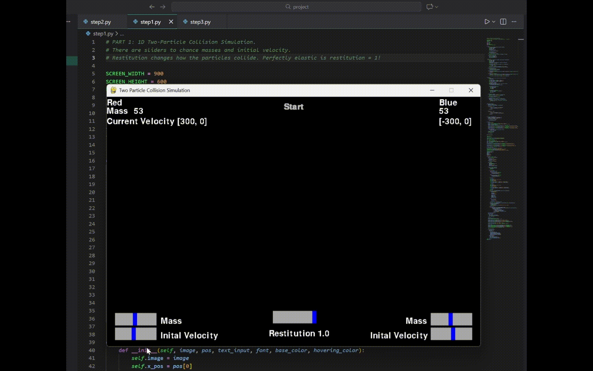
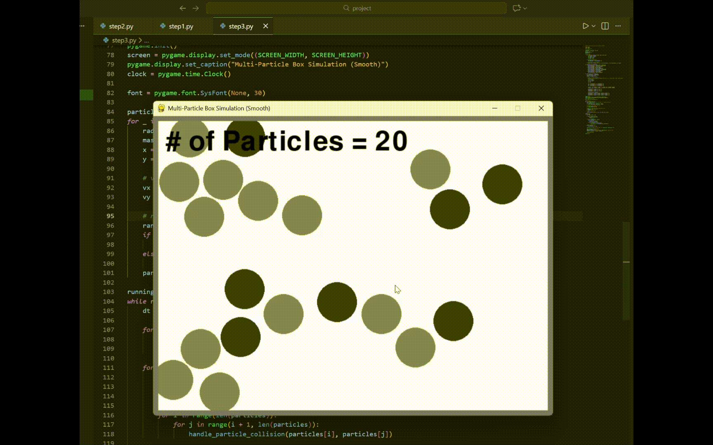

# 2D Particle Dynamics & Collision Simulator

An interactive physics simulation built in Python to explore elastic collisions, wall interactions, and multi-particle boundary mechanics. Includes real-time rendering through Pygame with automated kinematic plotting (position and velocity over time) with Matplotlib.

---

## Demos

| Part 1: Two-Particle Collision | Part 3: Multi-Particle Enclosure |
| :---: | :---: |
|  |  |

---

## The 3 Simulation Stages

The project is structured into three progressive development phases to validate collision physics from basic 1D kinematics up to planar multi-body environments:

### Part 1: Two-Particle Collision & Mass Influence
Simulates head-on, perfectly elastic collisions along the horizontal axis to evaluate momentum and kinetic energy transfer under varying initial conditions:
- **Equal Mass Benchmark (m₁ = 20, m₂ = 20, v = 200 px/s):** Symmetrical velocity exchange.
- **Asymmetric Mass Benchmark (m₁ = 20, m₂ = 5, v = 200 px/s):** Velocity amplification and mass-dependent rebound dynamics.
- Generates continuous position vs. time and velocity vs. time plots to verify conservation principles against analytical models.

### Part 2: Particle-Wall Interactions
Introduces static boundary constraints along the horizontal axis to model energy transfer with environment perimeters:
- **Reflective Boundary:** Elastic boundary collision where the normal velocity vector is completely inverted (`v_x = -v_x`).
- **Absorbing Boundary:** Completely inelastic interaction where normal momentum is stripped on impact, bringing the particle to rest (`v_x = 0`).

### Part 3: Configurable 2D Multi-Particle System
Combines inter-particle collision handling and boundary constraints into an interactive planar environment:
- Supports a user-configurable number of particles (N, e.g., N = 15) spawned inside a closed, reflective boundary.
- Simulates planar movement governed by independent X and Y velocity components (v_x, v_y).
- Resolves continuous particle-particle contacts and boundary rebounds across all active bodies in the arena.

---

## Theoretical Model

For 1D elastic collisions, post-collision velocities (v₁, v₂) are derived directly from the conservation of momentum and total kinetic energy:

### Governing Laws
- **Conservation of Momentum:** `m₁u₁ + m₂u₂ = m₁v₁ + m₂v₂`
- **Conservation of Kinetic Energy:** `½m₁u₁² + ½m₂u₂² = ½m₁v₁² + ½m₂v₂²`

### Analytical Velocity Solutions
```text
v₁ = ((m₁ - m₂) / (m₁ + m₂)) * u₁ + ((2 * m₂) / (m₁ + m₂)) * u₂
v₂ = ((2 * m₁) / (m₁ + m₂)) * u₁ + ((m₂ - m₁) / (m₁ + m₂)) * u₂
